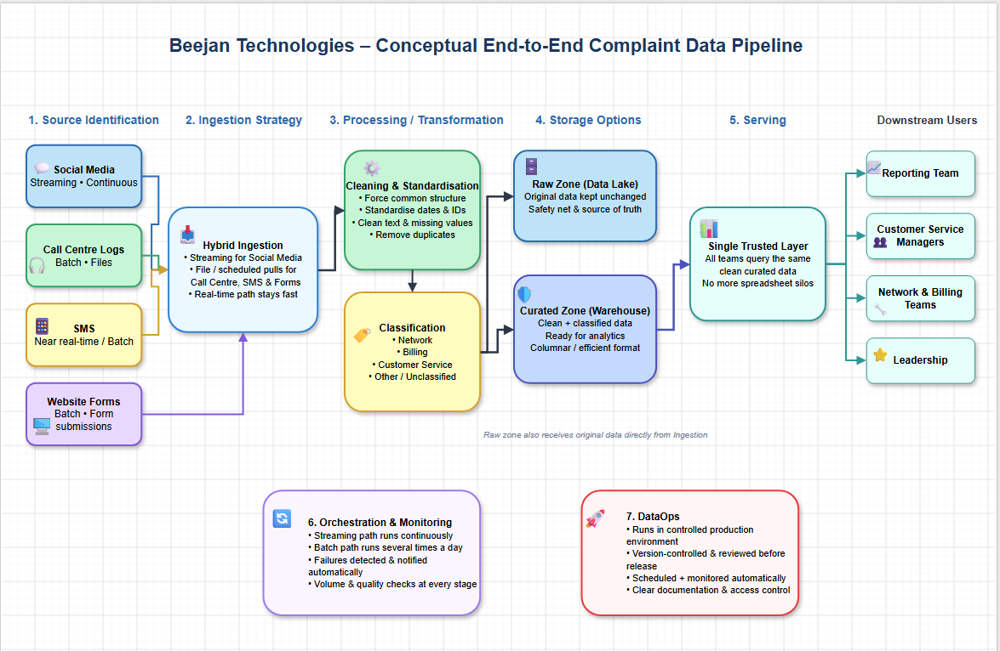

# CDE Bootcamp 3: Data Engineering Learning Journal

This repository documents my **Core Data Engineers Bootcamp 3** journey from data engineering foundations through Linux, Git, SQL, Python, data modeling, Change Data Capture, lakehouse architecture, production-minded dbt development on Databricks, and Docker containerization.

The material combines class notes, architecture diagrams, commands, code examples, troubleshooting records, and practical assignments. The aim is not simply to collect tools, but to follow data from raw source to trusted model and then package the supporting applications so they run reliably anywhere.

## Repository Contents

```text
cdebootcamp3/
|-- assignments/               # Architecture and automation projects
|   |-- A1-DataEngineeringFundamentals.md
|   `-- linux-git-project-A2/
|-- classes/                   # Notes and placeholders for Sessions 01-29
|   |-- assets/                # SQL scripts and practical training files
|   |   `-- python_ipynb/      # Four days of Python notebooks and solutions
|   |-- 01DengFundamentals1.md
|   |-- ...
|   `-- 29DOCKER2.md
`-- README.md
```

The companion [dbt project](../cdc_modeling/cdc_marketing/) contains the working Databricks adapter, dbt profile, models, tests, generated artifacts, and dependency configuration used during the dbt sessions.

## Learning Roadmap

### Data engineering, Linux, and Git

| Session | Class | Main topics |
| :---: | :--- | :--- |
| 01 | [Data Engineering Fundamentals I](classes/01DengFundamentals1.md) | Data lifecycles, ingestion, storage, ETL/ELT, OLTP, OLAP, and pipeline architecture |
| 02 | [Data Engineering Fundamentals II](classes/02DengFundamentals2.md) | Compute, storage, networking, system architecture, cloud concepts, and DataOps |
| 03 | [Linux I](classes/03Linux1.md) | Linux fundamentals, filesystems, terminal navigation, and command-line operations |
| 04 | [Git I](classes/04Git1.md) | Version control, repositories, staging, commits, branches, and remotes |
| 05 | [Linux II](classes/05Linux2.md) | Shells, pipes, redirection, text processing, permissions, and users |
| 06 | [Linux III](classes/06Linux3.md) | System administration, scheduling, automation, and deeper Linux operations |
| 07 | [Git II](classes/07Git2.md) | Collaboration, pull requests, merging, conflict handling, and branch protection |
| 08 | [Git III](classes/08Git3.md) | CI/CD, GitHub Actions, code review, and production Git workflows |
| 11 | [Data Engineering Fundamentals Review](classes/11DengFundamentalsReviewSession.md) | Batch versus streaming, medallion layers, resilience, architecture trade-offs, and peer design review |

### SQL

| Session | Class | Main topics |
| :---: | :--- | :--- |
| 09 | [SQL I: RDBMS Foundations](classes/09SQL1.md) | Data classification, normalization, DDL/DML, transactions, keys, and referential integrity |
| 10 | [SQL II: Querying Data](classes/10SQL2.md) | DQL, filtering, dates, sorting, aggregation, `WHERE`, and `HAVING` |
| 12 | [SQL III: Aggregation and Data Cleaning](classes/12SQL3.md) | Arithmetic and BODMAS, divide-by-zero safety, aggregate functions, `GROUP BY`, `HAVING`, `COALESCE`, `CASE`, strings, and type conversion |
| 13 | [SQL IV](classes/13SQL4.md) | Class file reserved; session notes have not yet been added |

### Python for data engineering

| Session | Class | Main topics |
| :---: | :--- | :--- |
| 14 | [Python I: Engineering Setup](classes/14Python1.md) | The data ecosystem, Python internals, Conda and `venv`, Jupyter, terminal workflows, PATH, and directory hygiene |
| 15 | [Python II: Primitives and Collections](classes/15Python2.md) | Variables, expressions, scalar types, strings, indexing, slicing, booleans, lists, tuples, and engineering mindset |
| 17 | [Python III: Operators and Control Flow](classes/17Python3.md) | Dictionaries, sets, arithmetic and logical operators, input, casting, object methods, conditionals, and loops |
| 20 | [Python V](classes/20Python5.md) | Class file reserved; session notes have not yet been added |
| 22 | [Python VI: Files, Pandas, and Production Practices](classes/22Python6.md) | Loop control, functions, object references, safe copying, comprehensions, file I/O, cursors, Pandas, and ecosystem architecture |
| 23 | [Python VII: Databases, APIs, and ETL](classes/23Python7.md) | Database drivers, parameterized SQL, transactions, REST APIs, pagination, exception handling, full loads, incremental ETL, and watermarks |

### Data modeling, CDC, and lakehouse architecture

| Session | Class | Main topics |
| :---: | :--- | :--- |
| 16 | [Data Modeling I: Foundations and Normalization](classes/16Modeling1.md) | Conceptual, logical, and physical models; entities; relationships; tables and views; 1NF, 2NF, 3NF; grain; composite and surrogate keys |
| 18 | [Data Modeling II: OLTP and OLAP Architecture](classes/18Python4.md) | Workload-driven design, OLTP versus OLAP, ERD cardinality, star/snowflake/OBT schemas, CDC, and telecom architecture |
| 19 | [Data Modeling III: Enterprise Pipeline Design](classes/19Modeling2.md) | Modeling phases, transactional and analytical workloads, cardinality, CDC, Databricks ingestion, dimensional serving, BI, and reverse ETL |
| 21 | [Medallion Architecture, CDC, and Governance](classes/21Modeling3.md) | PostgreSQL-to-Databricks ingestion, full and incremental sync, cursor selection, Bronze/Silver/Gold layers, semantic definitions, PII controls, LLMs, and reverse ETL |

### dbt, Databricks, and data observability

| Session | Class | Main topics |
| :---: | :--- | :--- |
| 24 | [dbt I: Modern Analytics Engineering](classes/24DBT1.md) | ETL versus ELT, dbt's role, Astral `uv`, adapter installation, project initialization, dbt directories, Databricks profiles, PATs, OAuth service principals, and CI/CD preparation |
| 25 | [dbt II: Connectivity, Debugging, and Compilation](classes/25DBT2.md) | dbt Core versus Cloud, Unity Catalog and SQL Warehouse setup, Windows/macOS/Linux configuration, `dbt debug`, compilation, execution, tests, static documentation, lineage, and troubleshooting |
| 26 | [dbt III: Modeling and Data Observability](classes/26DBT3.md) | dbt package management, environment-based Databricks profiles, normalized marketing entities, modular source declarations, source freshness, dbt tests, Elementary observability reports, and troubleshooting |
| 28 | [dbt IV: Layered Modeling and DAG Lineage](classes/28DBT4.md) | Staging, intermediate, and marts layers; configuration precedence; Jinja `source()` and `ref()`; deduplication with window functions; graph operators; reusable tests; AI-ready documentation; and lineage troubleshooting |

### Docker and containerization

| Session | Class | Main topics |
| :---: | :--- | :--- |
| 27 | [Docker I: Containerization Foundations](classes/27DOCKER1.md) | Deployment environment mismatches, virtual machines versus virtual environments, Linux namespaces and control groups, Docker on Windows and macOS, Dockerfiles, images, containers, and reproducible builds |
| 29 | [Docker II: Images, Layers, and Container Lifecycles](classes/29DOCKER2.md) | Image immutability, writable container layers, foreground process lifecycles, stopped versus removed containers, build-cache invalidation, Dockerfile optimization, image building, execution, and debugging |

> **Documentation status:** Sessions 13 and 20 currently contain empty placeholder files. Sessions 28 and 29 are now fully documented.

## Practical Assets

The class material is supported by runnable examples in [classes/assets](classes/assets/):

### SQL practice

- [Parch & Posey table creation](classes/assets/Parch_and_Posey_Create_Table.sql)
- [Parch & Posey sample data](classes/assets/Parch_and_Posey_Insert_Data.sql)
- [DML practice](<classes/assets/DML SQL Script.sql>)
- [`SELECT` and `WHERE` practice](classes/assets/01_SELECT_WHERE.sql)
- [Sorting, filtering, and date queries](classes/assets/02_SORTING_FILTERING_DATES.sql)

### Python training notebooks

The [Python notebook collection](classes/assets/python_ipynb/) contains 31 class training files organized by teaching day. It includes guided exercises, revised versions, worked solutions, and focused examples that progress from Python syntax to complete data pipelines:

- **Day 1 — Python foundations:** environment setup, Jupyter, expressions, variables, core data structures, operators, decisions, and loops. Start with [Python basics](classes/assets/python_ipynb/day_1/1._python_basic_intro.ipynb), then continue to [operators](classes/assets/python_ipynb/day_1/2._python_operators.ipynb) and [control flow](classes/assets/python_ipynb/day_1/3._python_control_flow.ipynb).
- **Day 2 — Reusable and resilient code:** [functions, modules, packages, errors, and exceptions](classes/assets/python_ipynb/day_2/4.python_functions_modules_errors.ipynb), with exercise and solution variants in the same folder.
- **Day 3 — Working with data:** detailed notebooks for [data structures](<classes/assets/python_ipynb/day_3/1. Detailed_Data_Structures.ipynb>), [file handling](<classes/assets/python_ipynb/day_3/2. Detailed_File_Handling.ipynb>), and [data manipulation with pandas](<classes/assets/python_ipynb/day_3/3. Detailed_Data_Manipulation_with_Pandas.ipynb>).
- **Day 4 — Data engineering with Python:** practical notebooks for [database interaction](<classes/assets/python_ipynb/day_4/1. Detailed_Database_Interaction.ipynb>), [APIs and web scraping](<classes/assets/python_ipynb/day_4/2. Comprehensive_API_Web_Scraping.ipynb>), [end-to-end ETL](<classes/assets/python_ipynb/day_4/3. Comprehensive_ETL_Data_Pipeline.ipynb>), and full versus incremental loading.
- **Bonus practice:** [choosing between dictionaries and lists of dictionaries](<classes/assets/python_ipynb/BONUS. Data_Shapes_dict_vs_list_of_dict.ipynb>) when navigating common data shapes.

## Practical Assignments

### Beejan Technologies complaint data pipeline

The [first assignment](assignments/A1-DataEngineeringFundamentals.md) designs an end-to-end customer complaint pipeline for social media, call-center logs, SMS, and website forms. It covers hybrid ingestion, cleaning, classification, layered storage, serving, orchestration, monitoring, and DataOps.



### Linux and Git automation project

The [second assignment](assignments/linux-git-project-A2/README.md) converts Linux, Bash, and Git concepts into working data engineering tools. It includes:

- An ETL script that downloads a public Stats NZ dataset and promotes selected data through raw, transformed, and Gold layers.
- An interactive recursive organizer for CSV and JSON files with overwrite protection and clear success, skip, and failure reporting.
- A cron configuration that schedules the ETL pipeline for midnight and records normal output and errors in a log.
- Version-controlled source data, transformed outputs, JSON/CSV examples, and shell scripts.

## Current Technical Milestone

The latest work closes the gap between writing transformations and engineering a maintainable data product. Raw marketing data now moves through explicit dbt layers with visible lineage and enforceable quality rules, while the Docker sessions show how application code and its runtime can be packaged as a repeatable deployment unit.

```text
Raw Facebook marketing tables in Databricks
	|
	| source() and lightweight staging views
	v
Typed, renamed, and documented source-aligned models
	|
	| ref(), joins, ROW_NUMBER(), and QUALIFY
	v
Deduplicated intermediate marketing model
	|
	| tests, lineage, documentation, and Elementary
	v
Trusted foundation for business-facing marts
```

The latest dbt work adds:

1. A clear separation between staging views, intermediate tables or incremental models, and business-facing marts.
2. Portable Jinja references with `source()` and `ref()` instead of hardcoded catalog paths.
3. Latest-record deduplication with `ROW_NUMBER()` and `QUALIFY` before joining accounts, campaigns, ad groups, and ads.
4. Generic and singular tests for uniqueness, accepted values, required columns, and business-specific failures.
5. Column-level metadata that improves both human understanding and the accuracy of tools such as Databricks Genie.
6. Targeted lineage builds with dbt graph operators, plus static documentation and Elementary reporting.

The Docker work turns the earlier containerization concepts into a practical operating model:

1. Images remain immutable even when a running container’s writable layer is changed or damaged.
2. A container lives only while its foreground process is running, and stopped containers remain until removed.
3. Dockerfile instructions create cached layers whose order directly affects rebuild speed.
4. Stable dependency files should be copied and installed before frequently changing application code.
5. The complete build-and-run loop now includes authoring a Dockerfile, tagging an image, starting a named container, inspecting its state, and troubleshooting local daemon or build-context failures.

The progression is documented across [Session 28](classes/28DBT4.md) for dbt and [Session 29](classes/29DOCKER2.md) for Docker.

## Core Engineering Principles

- Begin with the business problem, consumers, workload, and service expectations before selecting tools.
- Separate write-optimized OLTP systems from read-optimized analytical workloads as systems scale.
- Preserve recoverable raw data, clean and conform reusable entities, and expose trusted business-ready outputs.
- Choose CDC cursor columns according to source semantics; immutable event IDs and mutable update timestamps solve different problems.
- Define table grain before choosing keys or writing transformations.
- Use normalization to protect transactional integrity and dimensional models to simplify analytical reads.
- Treat Python and SQL as engineering tools for automation, validation, integration, and reliable data movement.
- Parameterize SQL, close resources deterministically, handle API pagination, and make incremental state explicit.
- Keep environments reproducible with dependency files and isolated runtimes.
- Keep credentials out of source control; use environment variables locally and managed secret stores in automation.
- Make SQL transformations modular and dependency-aware with dbt `ref()` and `source()`.
- Give staging, intermediate, and marts models distinct responsibilities and materializations.
- Document columns as part of the data contract so people, BI tools, and AI agents interpret them consistently.
- Monitor source freshness, test relational assumptions, and expose failures through observability tooling.
- Package application code with its system dependencies so it behaves consistently across development and production.
- Pin dependency versions and treat container images as immutable, reproducible deployment units.
- Order Dockerfile instructions from least frequently changed to most frequently changed to preserve useful build-cache layers.
- Keep persistent data outside disposable containers by using appropriate mounted storage.
- Test, review, observe, document, and secure data products as part of their implementation, not as afterthoughts.

## Suggested Reading Order

Follow Sessions 01-29 in numerical order for the full progression, skipping Sessions 13 and 20 until their notes are added. The sequence moves from system fundamentals into operating-system and collaboration skills, then SQL and Python, followed by workload-aware modeling, CDC and lakehouse governance, layered dbt development on Databricks, and hands-on Docker containerization.

For a topic-focused route:

- **Data Engineering Fundamentals:** Sessions 01, 02, and 11
- **Linux:** Sessions 03, 05, and 06
- **Git:** Sessions 04, 07, and 08
- **SQL:** Sessions 09, 10, 12, and 13 *(Session 13 is reserved)*
- **Python:** Sessions 14, 15, 17, 20, 22, and 23 *(Session 20 is reserved)*
- **Data Modeling:** Sessions 16, 18, 19, and 21
- **dbt:** Sessions 24, 25, 26, and 28
- **Docker:** Sessions 27 and 29
- **Hands-on projects:** [assignments](assignments/) and [class assets](classes/assets/)

Each populated class file is designed to work as a standalone technical reference, so readers can also jump directly to the topic they need.

## About This Repository

This is an evolving collection of notes and assignments from **CDE Bootcamp 3**. It records both technical lessons and the professional habits required to build dependable data systems, from raw operational events to tested analytical models and portable application runtimes.

---

<p align="center"><strong>From raw events to reliable, portable data products.</strong></p>
