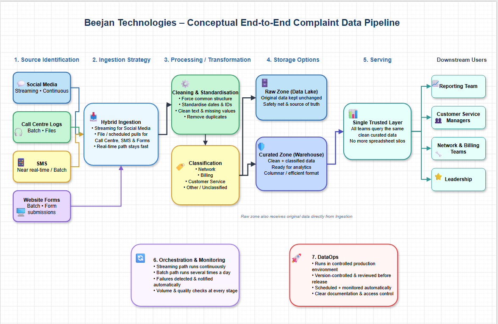

# CDE Bootcamp 3: Data Engineering Learning Journal

**From the first shell command to cloud-connected data pipelines: learn the tools, understand the architecture, and engineer for failure.**

This repository documents my **Core Data Engineers Bootcamp 3** journey through data engineering foundations, Linux, Git, SQL, Python, data modeling, Change Data Capture (CDC), lakehouse architecture, dbt on Databricks, Docker, Airbyte ingestion, Apache Airflow orchestration, and AWS identity and networking.

The material combines class notes, architecture diagrams, commands, code examples, troubleshooting records, and practical assignments. The goal is not to collect tools in isolation: it is to understand how data moves from operational sources to trusted analytical products, how workflows recover when something breaks, and how permissions, networking, and cost shape the architecture.

**At a glance:** 49 numbered session files, including 46 substantive class notes and 3 placeholders; 2 practical assignments; SQL practice scripts; and 31 Python training notebooks, excluding Jupyter checkpoints.

## Start Here

- **Follow the journey:** use the [learning roadmap](#learning-roadmap) for a session-by-session index grouped by topic.
- **Get hands-on:** explore the [practical assets](#practical-assets) and [assignments](#practical-assignments).
- **See how the pieces connect:** read the [current technical milestone](#current-technical-milestone).
- **Choose your route:** use the [suggested reading order](#suggested-reading-order) for sequential or topic-focused study.

This is a learning journal and reference collection, not a single deployable application. Examples span different tools, environments, and software versions; use each session's setup instructions and distinguish classroom demonstrations from production recommendations.

## Repository Contents

```text
cdebootcamp3/
|-- assignments/               # Architecture and automation projects
|   |-- A1-DataEngineeringFundamentals.md
|   |-- assets/                # Complaint pipeline architecture diagram
|   `-- linux-git-project-A2/   # Bash ETL, file organization, and cron
|-- classes/                   # Notes and placeholders for Sessions 01-49
|   |-- assets/                # SQL scripts and practical training files
|   |   `-- python_ipynb/      # Four days of Python notebooks and solutions
|   |-- 01DengFundamentals1.md
|   |-- ...
|   |-- 38AIRBYTE4.md
|   |-- 39Airflow1.md
|   |-- ...
|   |-- 42DBT_review.md
|   |-- ...
|   `-- 49AWS3.md
`-- README.md
```

**Local companion project:** the sibling workspace directory `..\cdc_modeling\cdc_marketing\` contains the dbt project used during the Databricks sessions, including adapter and dependency configuration, profiles, macros, models, tests, and generated artifacts. It is outside this Git repository and is not included when this repository is cloned.

## Learning Roadmap

Session numbers preserve the class sequence; the tables group related subjects for easier browsing. The original filenames are retained, including [Session 18](classes/18Python4.md), which covers data modeling despite its Python filename.

### Data engineering, Linux, and Git

| Session | Class | Main topics |
| :---: | :--- | :--- |
| 01 | [Data Engineering Fundamentals I](classes/01DengFundamentals1.md) | Data lifecycles, ingestion, storage, ETL/ELT, OLTP, OLAP, and pipeline architecture |
| 02 | [Data Engineering Fundamentals II](classes/02DengFundamentals2.md) | Compute, storage, networking, system architecture, cloud concepts, and DataOps |
| 03 | [Linux I](classes/03Linux1.md) | Linux fundamentals, filesystems, terminal navigation, and command-line operations |
| 04 | [Git I](classes/04Git1.md) | Version control, repositories, staging, commits, branches, and remotes |
| 05 | [Linux II](classes/05Linux2.md) | Shells, pipes, redirection, text processing, permissions, and users |
| 06 | [Linux III](classes/06Linux3.md) | System administration, scheduling, automation, and deeper Linux operations |
| 07 | [Git II](classes/07Git2.md) | Collaboration, pull requests, merging, conflict handling, and branch protection |
| 08 | [Git III](classes/08Git3.md) | CI/CD, GitHub Actions, code review, and production Git workflows |
| 11 | [Data Engineering Fundamentals Review](classes/11DengFundamentalsReviewSession.md) | Batch versus streaming, medallion layers, resilience, architecture trade-offs, and peer design review |

### SQL

| Session | Class | Main topics |
| :---: | :--- | :--- |
| 09 | [SQL I: RDBMS Foundations](classes/09SQL1.md) | Data classification, normalization, DDL/DML, transactions, keys, and referential integrity |
| 10 | [SQL II: Querying Data](classes/10SQL2.md) | DQL, filtering, dates, sorting, aggregation, `WHERE`, and `HAVING` |
| 12 | [SQL III: Aggregation and Data Cleaning](classes/12SQL3.md) | Arithmetic and BODMAS, divide-by-zero safety, aggregate functions, `GROUP BY`, `HAVING`, `COALESCE`, `CASE`, strings, and type conversion |
| 13 | [SQL IV](classes/13SQL4.md) | Class file reserved; session notes have not yet been added |

### Python for data engineering

| Session | Class | Main topics |
| :---: | :--- | :--- |
| 14 | [Python I: Engineering Setup](classes/14Python1.md) | The data ecosystem, Python internals, Conda and `venv`, Jupyter, terminal workflows, PATH, and directory hygiene |
| 15 | [Python II: Primitives and Collections](classes/15Python2.md) | Variables, expressions, scalar types, strings, indexing, slicing, booleans, lists, tuples, and engineering mindset |
| 17 | [Python III: Operators and Control Flow](classes/17Python3.md) | Dictionaries, sets, arithmetic and logical operators, input, casting, object methods, conditionals, and loops |
| 20 | [Python V](classes/20Python5.md) | Class file reserved; session notes have not yet been added |
| 22 | [Python VI: Files, Pandas, and Production Practices](classes/22Python6.md) | Loop control, functions, object references, safe copying, comprehensions, file I/O, cursors, Pandas, and ecosystem architecture |
| 23 | [Python VII: Databases, APIs, and ETL](classes/23Python7.md) | Database drivers, parameterized SQL, transactions, REST APIs, pagination, exception handling, full loads, incremental ETL, and watermarks |

### Data modeling, CDC, and lakehouse architecture

| Session | Class | Main topics |
| :---: | :--- | :--- |
| 16 | [Data Modeling I: Foundations and Normalization](classes/16Modeling1.md) | Conceptual, logical, and physical models; entities; relationships; tables and views; 1NF, 2NF, 3NF; grain; composite and surrogate keys |
| 18 | [Data Modeling II: OLTP and OLAP Architecture](classes/18Python4.md) | Workload-driven design, OLTP versus OLAP, ERD cardinality, star/snowflake/OBT schemas, CDC, and telecom architecture |
| 19 | [Data Modeling III: Enterprise Pipeline Design](classes/19Modeling2.md) | Modeling phases, transactional and analytical workloads, cardinality, CDC, Databricks ingestion, dimensional serving, BI, and reverse ETL |
| 21 | [Medallion Architecture, CDC, and Governance](classes/21Modeling3.md) | PostgreSQL-to-Databricks ingestion, full and incremental sync, cursor selection, Bronze/Silver/Gold layers, semantic definitions, PII controls, LLMs, and reverse ETL |

### dbt, Databricks, and data observability

| Session | Class | Main topics |
| :---: | :--- | :--- |
| 24 | [dbt I: Modern Analytics Engineering](classes/24DBT1.md) | ETL versus ELT, dbt's role, Astral `uv`, adapter installation, project initialization, dbt directories, Databricks profiles, PATs, OAuth service principals, and CI/CD preparation |
| 25 | [dbt II: Connectivity, Debugging, and Compilation](classes/25DBT2.md) | dbt Core versus Cloud, Unity Catalog and SQL Warehouse setup, Windows/macOS/Linux configuration, `dbt debug`, compilation, execution, tests, static documentation, lineage, and troubleshooting |
| 26 | [dbt III: Modeling and Data Observability](classes/26DBT3.md) | dbt package management, environment-based Databricks profiles, normalized marketing entities, modular source declarations, source freshness, dbt tests, Elementary observability reports, and troubleshooting |
| 28 | [dbt IV: Layered Modeling and DAG Lineage](classes/28DBT4.md) | Staging, intermediate, and marts layers; configuration precedence; Jinja `source()` and `ref()`; deduplication with window functions; graph operators; reusable tests; AI-ready documentation; and lineage troubleshooting |
| 30 | [dbt V: Production-Grade Optimization](classes/30DBT5.md) | Dynamic database and schema macros, environment isolation, CI/CD safety, dimensional modeling, incremental strategies, merge versus append, and microbatch optimization |
| 42 | [dbt Case Study: Cross-Platform Attribution and CI/CD](classes/42DBT_review.md) | Facebook and Snapchat model conformance, grain and currency pitfalls, `dbt_utils.union_relations`, column-level lineage, Unity Catalog governance, ephemeral PR schemas, `dbt-project-evaluator`, `--empty`, and Slim CI |

### Docker and containerization

| Session | Class | Main topics |
| :---: | :--- | :--- |
| 27 | [Docker I: Containerization Foundations](classes/27DOCKER1.md) | Deployment environment mismatches, virtual machines versus virtual environments, Linux namespaces and control groups, Docker on Windows and macOS, Dockerfiles, images, containers, and reproducible builds |
| 29 | [Docker II: Images, Layers, and Container Lifecycles](classes/29DOCKER2.md) | Image immutability, writable container layers, foreground process lifecycles, stopped versus removed containers, build-cache invalidation, Dockerfile optimization, image building, execution, and debugging |
| 31 | [Docker III: Caching, Execution, and Working Directories](classes/31DOCKER3.md) | Image history, layer-cache invalidation, `docker exec`, `docker run` versus `docker start`, `WORKDIR`, and containerized data pipeline tasks |
| 32 | [Docker IV: Volumes, Ports, and Persistence](classes/32DOCKER4.md) | Ephemeral container storage, bind mounts and volumes, port mapping, persistent PostgreSQL containers, host-container communication, and DBeaver connectivity |
| 34 | [Docker V](classes/34DOCKER5.md) | Class file reserved; full session notes have not yet been added |
| 35 | [Docker VI: Compose and Production Optimization](classes/35DOCKER6.md) | Docker Engine architecture, `CMD` versus `ENTRYPOINT`, Compose services, YAML reuse, multi-stage builds, non-root containers, and resource limits |

### Airbyte and production data ingestion

| Session | Class | Main topics |
| :---: | :--- | :--- |
| 33 | [Airbyte I: Modern Data Movement](classes/33AIRBYTE1.md) | OLTP-to-OLAP data movement, ETL versus ELT and Reverse ETL, data at rest versus in motion, ingestion architecture, and Airbyte fundamentals |
| 36 | [Airbyte II: Lakehouse Integration](classes/36AIRBYTE2.md) | Engineering onboarding, medallion architecture, cloud compute and storage economics, and an end-to-end PostgreSQL-to-Snowflake Airbyte pipeline |
| 37 | [Airbyte III: Sync Strategies and Resilient Architecture](classes/37AIRBYTE3.md) | Full refresh versus incremental replication, cursor-based ingestion, CDC internals, source fidelity, staging patterns, production triage, and warehouse time travel |
| 38 | [Airbyte IV: Custom Connectors and Production Warehousing](classes/38AIRBYTE4.md) | Airbyte sync modes, incremental append and deduplication, API connector development, pagination, schema evolution, POC safety, and semi-structured JSON handling |

### Apache Airflow and workflow orchestration

| Session | Class | Main topics |
| :---: | :--- | :--- |
| 39 | [Airflow I: Why Orchestration Matters](classes/39Airflow1.md) | Dependencies, scheduling, retries, visibility, the CDE Bites pipeline, limitations of manual scripts and cron, orchestrator selection, and Airflow versus Airbyte |
| 40 | [Airflow II: Your First DAG](classes/40Airflow2.md) | Pipelines as code, Python classes and operators, DAG construction, task dependencies, providers, the Airflow UI, monitoring, and targeted failure recovery |
| 41 | [Airflow III: Architecture, Executors, and Debugging](classes/41Airflow3.md) | Metadata database, scheduler, API server, DAG processor, executor, workers, triggerer, Local/Celery/Kubernetes execution, Docker Compose, orders DAG implementation, and host-container path troubleshooting |
| 43 | [Airflow IV: Modular DAGs and Pushdown Compute](classes/43Airflow4.md) | Parse-time side effects, reusable utility modules, warehouse-side SQL execution, operators versus hooks and connections, provider installation, custom Docker images, and permissions |
| 44 | [Airflow V: TaskFlow, Secrets, and Task Communication](classes/44Airflow5.md) | External templated SQL, compute boundaries, centralized secrets backends, `PostgresHook`, `@dag` and `@task`, runtime context, and XComs |
| 45 | [Airflow VI: Alerting, Variables, and Branching](classes/45Airflow6.md) | Separating reporting from notification, `EmailOperator`, SMTP setup, Jinja templates, XCom return values, runtime Variables, and conditional execution with `BranchPythonOperator` |
| 46 | [Airflow VII: Convergence, Scheduling, and Production](classes/46Airflow7.md) | Fan-in cleanup, skipped-task behavior, trigger rules, cron and interval scheduling, catchup and backfills, tags and defaults, failure callbacks, and deployment trade-offs |

### AWS cloud foundations, IAM, and networking

| Session | Class | Main topics |
| :---: | :--- | :--- |
| 47 | [AWS I: Infrastructure and Identity](classes/47AWS1.md) | On-premises versus cloud infrastructure, Regions and Availability Zones, data residency, authentication versus authorization, IAM identities, ARNs, policy structure, PII access boundaries, and the IAM/VPC/EC2 foundation |
| 48 | [AWS II: Least-Privilege Policies and S3 Access](classes/48AWS2.md) | Wildcard matching, actions versus resources, scoped IAM administration, group policies, bucket versus object ARNs, S3 listing and read permissions, and permission troubleshooting |
| 49 | [AWS III: Networking and Pipeline Connectivity](classes/49AWS3.md) | VPC fundamentals, IPv4, CIDR prefixes and subnet masks, public versus private IPs, security-group rules, DNS, ports, RDS/PostgreSQL and Redshift connection troubleshooting, and data-egress costs |

> **Documentation status:** Sessions 01-49 are indexed here. Sessions 13 and 20 are empty placeholders; Session 34 contains only a brief placeholder. The remaining 46 sessions contain substantive notes, including the Airflow sequence, dbt case-study review, and AWS foundations.

## Practical Assets

The class material is supported by runnable examples in [classes/assets](classes/assets/):

### SQL practice

- [Parch & Posey table creation](classes/assets/Parch_and_Posey_Create_Table.sql)
- [Parch & Posey sample data](classes/assets/Parch_and_Posey_Insert_Data.sql)
- [DML practice](<classes/assets/DML SQL Script.sql>)
- [`SELECT` and `WHERE` practice](classes/assets/01_SELECT_WHERE.sql)
- [Sorting, filtering, and date queries](classes/assets/02_SORTING_FILTERING_DATES.sql)

### Python training notebooks

The [Python notebook collection](classes/assets/python_ipynb/) contains 31 training notebooks across four teaching-day folders and bonus practice, excluding Jupyter checkpoint copies. It includes guided exercises, revised versions, worked solutions, and focused examples that progress from Python syntax to complete data pipelines:

- **Day 1 — Python foundations:** environment setup, Jupyter, expressions, variables, core data structures, operators, decisions, and loops. Start with [Python basics](classes/assets/python_ipynb/day_1/1._python_basic_intro.ipynb), then continue to [operators](classes/assets/python_ipynb/day_1/2._python_operators.ipynb) and [control flow](classes/assets/python_ipynb/day_1/3._python_control_flow.ipynb).
- **Day 2 — Reusable and resilient code:** [functions, modules, packages, errors, and exceptions](classes/assets/python_ipynb/day_2/4.python_functions_modules_errors.ipynb), with exercise and solution variants in the same folder.
- **Day 3 — Working with data:** detailed notebooks for [data structures](<classes/assets/python_ipynb/day_3/1. Detailed_Data_Structures.ipynb>), [file handling](<classes/assets/python_ipynb/day_3/2. Detailed_File_Handling.ipynb>), and [data manipulation with pandas](<classes/assets/python_ipynb/day_3/3. Detailed_Data_Manipulation_with_Pandas.ipynb>).
- **Day 4 — Data engineering with Python:** practical notebooks for [database interaction](<classes/assets/python_ipynb/day_4/1. Detailed_Database_Interaction.ipynb>), [APIs and web scraping](<classes/assets/python_ipynb/day_4/2. Comprehensive_API_Web_Scraping.ipynb>), [end-to-end ETL](<classes/assets/python_ipynb/day_4/3. Comprehensive_ETL_Data_Pipeline.ipynb>), and full versus incremental loading.
- **Bonus practice:** [choosing between dictionaries and lists of dictionaries](<classes/assets/python_ipynb/BONUS. Data_Shapes_dict_vs_list_of_dict.ipynb>) when navigating common data shapes.

**Before running examples:** use an isolated Python environment and install the dependencies required by the chosen notebook. Database, API, and cloud exercises may also require separately configured services and credentials. For the Bash assignment, follow its own [requirements and usage instructions](assignments/linux-git-project-A2/README.md); these are not repository-wide setup steps.

## Practical Assignments

### Beejan Technologies complaint data pipeline

The [first assignment](assignments/A1-DataEngineeringFundamentals.md) designs an end-to-end customer complaint pipeline for social media, call-center logs, SMS, and website forms. It covers hybrid ingestion, cleaning, classification, layered storage, serving, orchestration, monitoring, and DataOps.



### Linux and Git automation project

The [second assignment](assignments/linux-git-project-A2/README.md) converts Linux, Bash, and Git concepts into working data engineering tools. It includes:

- An ETL script that downloads a public Stats NZ dataset and promotes selected data through raw, transformed, and Gold layers.
- An interactive recursive organizer for CSV and JSON files with overwrite protection and clear success, skip, and failure reporting.
- A cron configuration that schedules the ETL pipeline for midnight and records normal output and errors in a log.
- Version-controlled source data, transformed outputs, JSON/CSV examples, and shell scripts.

## Current Technical Milestone

### From moving data to operating a data platform

The learning arc now connects ingestion, transformation, orchestration, and cloud foundations. Airbyte moves source data; dbt builds tested analytical models in the destination; Airflow coordinates batch workflow dependencies and recovery; Docker packages supporting runtimes; and AWS introduces the identity, network, and cost boundaries those workloads must respect.

The diagram below is a conceptual synthesis of the sessions, not a claim that one complete production stack is deployed from this repository.

```text
Operational databases, SaaS APIs, and event sources
        |
        | Airbyte full-refresh, incremental, or CDC ingestion
        v
Raw / Bronze landing layer with source fidelity
        |
        | dbt staging, testing, deduplication, and enrichment
        v
Conformed Silver models and business-facing Gold marts
        |
        v
BI, ML, reverse ETL, and operational consumption

Across the workflow:
  Airflow  -> schedules, dependencies, retries, branching, and alerts
  Docker   -> packaged services and reproducible runtime environments
  AWS      -> IAM permissions, network connectivity, and cost controls
```

### dbt and Docker: model with confidence, run consistently

The advanced dbt work now includes dynamic database and schema macros, safe environment routing, CI/CD-controlled production targets, dimensional marts, and incremental strategies ranging from merge and append to microbatch processing. These topics build on the layered models, tests, lineage, documentation, and Elementary observability established in earlier sessions.

The [dbt case-study review](classes/42DBT_review.md) brings those ideas together around cross-platform marketing attribution: reconcile Facebook and Snapchat entities without losing grain, examine currency and timezone assumptions, inspect column-level lineage, distinguish Unity Catalog boundaries from workspace boundaries, and use isolated PR schemas and state-aware Slim CI to validate changes efficiently.

The Docker notes cover image forensics and cache optimization, interactive container inspection, working-directory hygiene, persistent volumes, port mapping, multi-container orchestration with Docker Compose, multi-stage builds, non-root execution, and CPU, memory, swap, and logging guardrails. Session 34 remains a placeholder rather than a completed reference.

### Airbyte: move data without losing its meaning

1. Select full-refresh, incremental append, or incremental append-and-deduplicate modes according to source behavior, volume, cost, cursor availability, and primary-key semantics.
2. Preserve raw source fidelity and treat cleanup, conformance, and enrichment as downstream transformation responsibilities.
3. Separate ingestion engines from orchestrators: Airbyte moves data, Airflow coordinates dependencies, and dbt transforms data in the destination.
4. Understand the difference between query-driven cursor polling and log-based CDC through database WAL or binlog internals.
5. Build API connectors with explicit record paths, pagination, schema handling, and state management.
6. Use isolated POC environments, synthetic test data, staging storage, observability, and warehouse time travel to reduce production risk.

Key references: [advanced dbt](classes/30DBT5.md), [Docker execution and caching](classes/31DOCKER3.md), [storage and networking](classes/32DOCKER4.md), [Compose and optimization](classes/35DOCKER6.md), and Airbyte [foundations](classes/33AIRBYTE1.md), [integration](classes/36AIRBYTE2.md), [sync strategies](classes/37AIRBYTE3.md), and [custom connectors](classes/38AIRBYTE4.md).

### Airflow: turn scripts into observable, recoverable workflows

The CDE Bites case study follows an orders pipeline from manually executed scripts and cron to dependency-aware DAGs. The [Airflow kickoff](classes/39Airflow1.md) establishes the orchestration problem; the following sessions develop the implementation and operational discipline:

1. Define tasks and dependencies as code, inspect execution in the UI, and recover failed tasks without blindly repeating the entire pipeline.
2. Understand the scheduler, metadata database, DAG processor, executor, workers, triggerer, and the trade-offs between Local, Celery, and Kubernetes execution.
3. Keep DAG parsing lightweight: move database calls, API requests, and runtime configuration lookups out of top-level code.
4. Separate orchestration from business logic; use reusable modules, external SQL templates, hooks, connections, provider packages, and managed secrets.
5. Use TaskFlow and runtime context where appropriate; pass small metadata through XComs rather than bulk datasets, and push heavy transformations into the warehouse.
6. Add reporting, email notifications, conditional branches, and explicit trigger rules so convergence and cleanup behave correctly when upstream tasks succeed, fail, or skip.
7. Reason about schedules, catchup, backfills, failure callbacks, deployment topology, and the difference between updating mounted code and rebuilding an image.

The [final Airflow session](classes/46Airflow7.md) closes the module with fan-in dependencies, cleanup, scheduling, and production trade-offs.

### AWS: permissions and connectivity are part of the pipeline

The latest [AWS networking session](classes/49AWS3.md) builds on [cloud and IAM foundations](classes/47AWS1.md) and [hands-on policy design](classes/48AWS2.md):

- Distinguish Regions and Availability Zones, weigh latency and residency requirements, and understand the roles of IAM, VPC, and EC2.
- Separate authentication from authorization; scope IAM actions and resource ARNs to the workload rather than granting blanket access.
- Distinguish S3 bucket-level operations from object-level reads, and test both allowed and denied access paths.
- Use IPv4, CIDR, DNS, endpoint ports, and security-group rules to reason about connectivity between ingestion tools, source databases, and warehouses.
- Diagnose network reachability separately from credentials and database permissions. Security-group rules alone do not create a route to a private endpoint.
- Account for data placement and chargeable transfer paths when estimating cost; do not assume every same-Region transfer is free.

The shift is practical: a correct SQL model cannot help if the source is unreachable, the role lacks access, or the architecture moves data at an unsustainable cost.

## Core Engineering Principles

- Begin with the business problem, consumers, workload, and service expectations before selecting tools.
- Separate write-optimized OLTP systems from read-optimized analytical workloads as systems scale.
- Preserve recoverable raw data, clean and conform reusable entities, and expose trusted business-ready outputs.
- Choose CDC cursor columns according to source semantics; immutable event IDs and mutable update timestamps solve different problems.
- Define table grain before choosing keys or writing transformations.
- Use normalization to protect transactional integrity and dimensional models to simplify analytical reads.
- Treat Python and SQL as engineering tools for automation, validation, integration, and reliable data movement.
- Parameterize SQL, close resources deterministically, handle API pagination, and make incremental state explicit.
- Keep environments reproducible with dependency files and isolated runtimes.
- Keep credentials out of source control; use environment variables locally and managed secret stores in automation.
- Make SQL transformations modular and dependency-aware with dbt `ref()` and `source()`.
- Give staging, intermediate, and marts models distinct responsibilities and materializations.
- Document columns as part of the data contract so people, BI tools, and AI agents interpret them consistently.
- Monitor source freshness, test relational assumptions, and expose failures through observability tooling.
- Package application code with its system dependencies so it behaves consistently across development and production.
- Pin dependency versions and treat container images as immutable, reproducible deployment units.
- Order Dockerfile instructions from least frequently changed to most frequently changed to preserve useful build-cache layers.
- Keep persistent data outside disposable containers by using appropriate mounted storage.
- Treat container networking, ports, volumes, process ownership, and resource limits as explicit production configuration.
- Choose ingestion sync modes from source mutability, data volume, cursor reliability, destination semantics, and recovery requirements.
- Keep ingestion, orchestration, transformation, and serving responsibilities separated across purpose-built tools.
- Preserve source fidelity in raw storage and make pipeline state, schema evolution, pagination, and deduplication explicit.
- Keep DAG definition and parsing free of network calls and other expensive side effects; perform work at task runtime.
- Use XComs for small task metadata and references, not as a transport for bulk data.
- Design branching, convergence, cleanup, retries, and trigger rules together; a skipped task is not the same as a failed one.
- Understand scheduling and data intervals before enabling catchup or launching historical backfills.
- Use least-privilege cloud identities and distinguish bucket-level permissions from object-level permissions.
- Debug connectivity in layers: DNS, routing, firewall rules, endpoint ports, authentication, and authorization.
- Treat cloud residency, compute placement, and data-transfer costs as design inputs, not billing surprises.
- Test, review, observe, document, and secure data products as part of their implementation, not as afterthoughts.

## Suggested Reading Order

Follow Sessions 01-49 in numerical order for the full progression, skipping Sessions 13, 20, and 34 until their notes are added. The sequence moves from system fundamentals into operating-system and collaboration skills, then SQL and Python, followed by workload-aware modeling, CDC and lakehouse governance, layered dbt development on Databricks, Docker containerization, Airbyte ingestion, Airflow orchestration, a dbt case-study review, and AWS identity and networking. Session 42 revisits dbt between Airflow sessions.

For a topic-focused route:

- **Data Engineering Fundamentals:** Sessions 01, 02, and 11
- **Linux:** Sessions 03, 05, and 06
- **Git:** Sessions 04, 07, and 08
- **SQL:** Sessions 09, 10, 12, and 13 *(Session 13 is reserved)*
- **Python:** Sessions 14, 15, 17, 20, 22, and 23 *(Session 20 is reserved)*
- **Data Modeling:** Sessions 16, 18, 19, and 21
- **dbt:** Sessions 24, 25, 26, 28, 30, and 42
- **Docker:** Sessions 27, 29, 31, 32, 34, and 35 *(Session 34 is reserved)*
- **Airbyte and ingestion:** Sessions 33, 36, 37, and 38
- **Airflow and orchestration:** Sessions 39, 40, 41, 43, 44, 45, and 46
- **AWS infrastructure, IAM, and networking:** Sessions 47, 48, and 49
- **Hands-on projects:** [assignments](assignments/) and [class assets](classes/assets/)

For a case-study route, start with the complaint-pipeline [architecture assignment](assignments/A1-DataEngineeringFundamentals.md), implement automation in the [Linux and Git project](assignments/linux-git-project-A2/README.md), follow the marketing-modeling work through the [dbt review](classes/42DBT_review.md), then trace the CDE Bites workflow from [orchestration foundations](classes/39Airflow1.md) to [operational scheduling and recovery](classes/46Airflow7.md). Finish with [AWS connectivity](classes/49AWS3.md) to see why permissions and networking belong in the same design conversation.

Each populated class file is designed to work as a standalone technical reference, so readers can also jump directly to the topic they need. Check the session's tool versions before reusing commands or imports, especially across Airflow and provider releases.

## About This Repository

This is an evolving collection of notes and assignments from **CDE Bootcamp 3**. It records both technical lessons and the professional habits required to build dependable data systems: ask better architectural questions, preserve the meaning of source data, make failures visible, recover deliberately, and understand the infrastructure beneath the pipeline.

---

<p align="center"><strong>Move the data. Model the meaning. Orchestrate the work. Understand the cloud.</strong></p>
