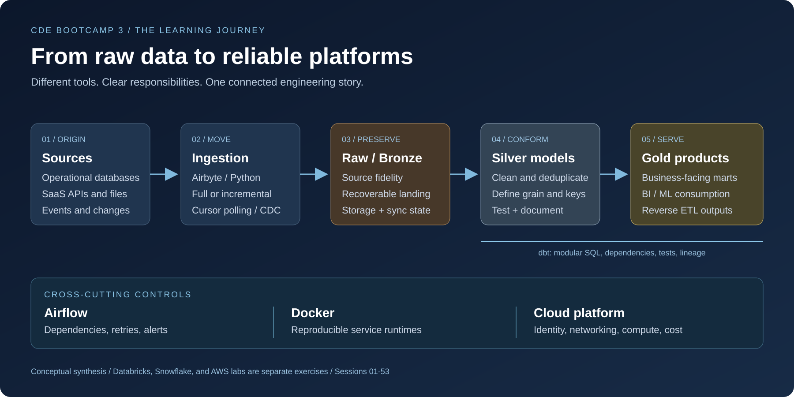
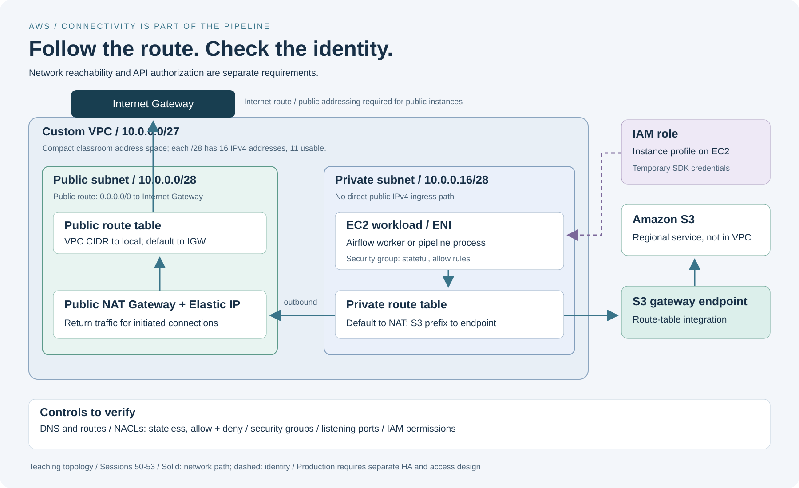
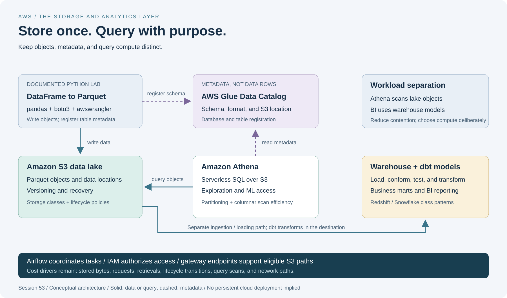

# CDE Bootcamp 3: From Raw Data to Reliable Platforms

**Move the data. Model the meaning. Make the platform dependable.**

A pipeline that runs once is a demonstration. A pipeline that preserves meaning, recovers from failure, respects access boundaries, and makes its costs understandable is an engineering system. This repository follows my **Core Data Engineers Bootcamp 3** journey toward that second kind of pipeline.

The progression starts with Linux, Git, SQL, and Python, then connects data modeling, Change Data Capture (CDC), dbt, Databricks, Docker, Airbyte, and Apache Airflow. The latest AWS sessions take the journey underneath the pipeline: identity, network routes, compute, resilient infrastructure, object storage, and serverless analytics.

**Progress through Session 53:** 50 substantive class notes, 3 placeholders, 2 assignments, 5 SQL practice scripts, and 31 Python training notebooks, excluding Jupyter checkpoints.



*A map of the concepts studied, not a single production deployment. Databricks, Snowflake, and AWS examples belong to distinct class exercises.*

## Start Here

- **Follow the journey:** use the [learning roadmap](#learning-roadmap) for a session-by-session index grouped by topic.
- **Get hands-on:** explore the [practical assets](#practical-assets) and [assignments](#practical-assignments).
- **Catch up on recent work:** read [what we have covered so far](#what-we-have-covered-so-far) and the [current technical milestone](#current-technical-milestone).
- **Understand the cloud architecture:** explore [network paths](#aws-from-a-network-diagram-to-a-working-connection) and the [S3, Glue, and Athena data lake](#s3-glue-and-athena-store-once-query-with-purpose).
- **Choose your route:** use the [suggested reading order](#suggested-reading-order) for sequential or topic-focused study.

This is a learning journal and reference collection, not a single deployable application. Examples span different tools, environments, and software versions; use each session's setup instructions and distinguish classroom demonstrations from production recommendations.

## What We Have Covered So Far

| Learning milestone | Work documented | Why it matters |
| :--- | :--- | :--- |
| Foundations and automation | Architecture trade-offs, Linux administration, Git collaboration, Bash ETL, and cron | Understand the system and automate repeatable work |
| Querying and integration | SQL practice, Python notebooks, files, pandas, databases, APIs, and incremental watermarks | Retrieve, validate, and move data deliberately |
| Modeling and analytics engineering | Normalization, grain, dimensional models, CDC, medallion layers, dbt tests, lineage, and CI/CD | Turn source records into consistent analytical products |
| Reproducible ingestion | Docker images, volumes, Compose, Airbyte sync modes, and custom API connectors | Separate runtime problems from data movement problems |
| Recoverable orchestration | Orders DAGs, TaskFlow, hooks, templated SQL, XComs, branching, alerts, and backfills | Coordinate dependencies and recover without guesswork |
| Cloud platform foundations | IAM, VPC labs, EC2, network controls, instance profiles, Auto Scaling, and NAT | Explain both who can access a workload and how traffic reaches it |
| Data lake and serverless analytics | S3 versioning and lifecycle policies, Parquet writes, Glue catalog registration, and Athena SQL | Separate stored data, metadata, and query compute |

The material includes **design proposals, runnable assets, recorded class demonstrations, and production patterns discussed in class**. These are different kinds of evidence: a documented lab is not a claim that its infrastructure remains deployed.

## Repository Contents

```text
cdebootcamp3/
|-- assignments/               # Architecture and automation projects
|   |-- A1-DataEngineeringFundamentals.md
|   |-- assets/                # Complaint pipeline architecture diagram
|   `-- linux-git-project-A2/   # Bash ETL, file organization, and cron
|-- classes/                   # Notes and placeholders for Sessions 01-53
|   |-- assets/                # Vector diagrams, SQL scripts, and training files
|   |   |-- data-platform-overview.svg
|   |   |-- aws-network-architecture.svg
|   |   |-- aws-data-lake-architecture.svg
|   |   `-- python_ipynb/      # Four days of Python notebooks and solutions
|   |-- 01DengFundamentals1.md
|   |-- ...
|   |-- 38AIRBYTE4.md
|   |-- 39Airflow1.md
|   |-- ...
|   |-- 42DBT_review.md
|   |-- ...
|   |-- 49AWS3.md
|   |-- ...
|   `-- 53AWS7.md
`-- README.md
```

**Scope boundary:** the dbt sessions refer to a companion project in the sibling workspace directory `..\cdc_modeling\cdc_marketing\`. It is outside this Git repository and is not included when this repository is cloned. Likewise, the class notes contain Airflow and cloud lab examples; this repository does not provide one root-level command to deploy every stack.

## Learning Roadmap

Session numbers preserve the class sequence; the tables group related subjects for easier browsing. The original filenames are retained, including [Session 18](classes/18Python4.md), which covers data modeling despite its Python filename.

### Data engineering, Linux, and Git

| Session | Class | Main topics |
| :---: | :--- | :--- |
| 01 | [Data Engineering Fundamentals I](classes/01DengFundamentals1.md) | Data lifecycles, ingestion, storage, ETL/ELT, OLTP, OLAP, and pipeline architecture |
| 02 | [Data Engineering Fundamentals II](classes/02DengFundamentals2.md) | Compute, storage, networking, system architecture, cloud concepts, and DataOps |
| 03 | [Linux I](classes/03Linux1.md) | Linux fundamentals, filesystems, terminal navigation, and command-line operations |
| 04 | [Git I](classes/04Git1.md) | Version control, repositories, staging, commits, branches, and remotes |
| 05 | [Linux II](classes/05Linux2.md) | Shells, pipes, redirection, text processing, permissions, and users |
| 06 | [Linux III](classes/06Linux3.md) | System administration, scheduling, automation, and deeper Linux operations |
| 07 | [Git II](classes/07Git2.md) | Collaboration, pull requests, merging, conflict handling, and branch protection |
| 08 | [Git III](classes/08Git3.md) | CI/CD, GitHub Actions, code review, and production Git workflows |
| 11 | [Data Engineering Fundamentals Review](classes/11DengFundamentalsReviewSession.md) | Batch versus streaming, medallion layers, resilience, architecture trade-offs, and peer design review |

### SQL

| Session | Class | Main topics |
| :---: | :--- | :--- |
| 09 | [SQL I: RDBMS Foundations](classes/09SQL1.md) | Data classification, normalization, DDL/DML, transactions, keys, and referential integrity |
| 10 | [SQL II: Querying Data](classes/10SQL2.md) | DQL, filtering, dates, sorting, aggregation, `WHERE`, and `HAVING` |
| 12 | [SQL III: Aggregation and Data Cleaning](classes/12SQL3.md) | Arithmetic and BODMAS, divide-by-zero safety, aggregate functions, `GROUP BY`, `HAVING`, `COALESCE`, `CASE`, strings, and type conversion |
| 13 | [SQL IV](classes/13SQL4.md) | Class file reserved; session notes have not yet been added |

### Python for data engineering

| Session | Class | Main topics |
| :---: | :--- | :--- |
| 14 | [Python I: Engineering Setup](classes/14Python1.md) | The data ecosystem, Python internals, Conda and `venv`, Jupyter, terminal workflows, PATH, and directory hygiene |
| 15 | [Python II: Primitives and Collections](classes/15Python2.md) | Variables, expressions, scalar types, strings, indexing, slicing, booleans, lists, tuples, and engineering mindset |
| 17 | [Python III: Operators and Control Flow](classes/17Python3.md) | Dictionaries, sets, arithmetic and logical operators, input, casting, object methods, conditionals, and loops |
| 20 | [Python V](classes/20Python5.md) | Class file reserved; session notes have not yet been added |
| 22 | [Python VI: Files, Pandas, and Production Practices](classes/22Python6.md) | Loop control, functions, object references, safe copying, comprehensions, file I/O, cursors, Pandas, and ecosystem architecture |
| 23 | [Python VII: Databases, APIs, and ETL](classes/23Python7.md) | Database drivers, parameterized SQL, transactions, REST APIs, pagination, exception handling, full loads, incremental ETL, and watermarks |

### Data modeling, CDC, and lakehouse architecture

| Session | Class | Main topics |
| :---: | :--- | :--- |
| 16 | [Data Modeling I: Foundations and Normalization](classes/16Modeling1.md) | Conceptual, logical, and physical models; entities; relationships; tables and views; 1NF, 2NF, 3NF; grain; composite and surrogate keys |
| 18 | [Data Modeling II: OLTP and OLAP Architecture](classes/18Python4.md) | Workload-driven design, OLTP versus OLAP, ERD cardinality, star/snowflake/OBT schemas, CDC, and telecom architecture |
| 19 | [Data Modeling III: Enterprise Pipeline Design](classes/19Modeling2.md) | Modeling phases, transactional and analytical workloads, cardinality, CDC, Databricks ingestion, dimensional serving, BI, and reverse ETL |
| 21 | [Medallion Architecture, CDC, and Governance](classes/21Modeling3.md) | PostgreSQL-to-Databricks ingestion, full and incremental sync, cursor selection, Bronze/Silver/Gold layers, semantic definitions, PII controls, LLMs, and reverse ETL |

### dbt, Databricks, and data observability

| Session | Class | Main topics |
| :---: | :--- | :--- |
| 24 | [dbt I: Modern Analytics Engineering](classes/24DBT1.md) | ETL versus ELT, dbt's role, Astral `uv`, adapter installation, project initialization, dbt directories, Databricks profiles, PATs, OAuth service principals, and CI/CD preparation |
| 25 | [dbt II: Connectivity, Debugging, and Compilation](classes/25DBT2.md) | dbt Core versus Cloud, Unity Catalog and SQL Warehouse setup, Windows/macOS/Linux configuration, `dbt debug`, compilation, execution, tests, static documentation, lineage, and troubleshooting |
| 26 | [dbt III: Modeling and Data Observability](classes/26DBT3.md) | dbt package management, environment-based Databricks profiles, normalized marketing entities, modular source declarations, source freshness, dbt tests, Elementary observability reports, and troubleshooting |
| 28 | [dbt IV: Layered Modeling and DAG Lineage](classes/28DBT4.md) | Staging, intermediate, and marts layers; configuration precedence; Jinja `source()` and `ref()`; deduplication with window functions; graph operators; reusable tests; AI-ready documentation; and lineage troubleshooting |
| 30 | [dbt V: Production-Grade Optimization](classes/30DBT5.md) | Dynamic database and schema macros, environment isolation, CI/CD safety, dimensional modeling, incremental strategies, merge versus append, and microbatch optimization |
| 42 | [dbt Case Study: Cross-Platform Attribution and CI/CD](classes/42DBT_review.md) | Facebook and Snapchat model conformance, grain and currency pitfalls, `dbt_utils.union_relations`, column-level lineage, Unity Catalog governance, ephemeral PR schemas, `dbt-project-evaluator`, `--empty`, and Slim CI |

### Docker and containerization

| Session | Class | Main topics |
| :---: | :--- | :--- |
| 27 | [Docker I: Containerization Foundations](classes/27DOCKER1.md) | Deployment environment mismatches, virtual machines versus virtual environments, Linux namespaces and control groups, Docker on Windows and macOS, Dockerfiles, images, containers, and reproducible builds |
| 29 | [Docker II: Images, Layers, and Container Lifecycles](classes/29DOCKER2.md) | Image immutability, writable container layers, foreground process lifecycles, stopped versus removed containers, build-cache invalidation, Dockerfile optimization, image building, execution, and debugging |
| 31 | [Docker III: Caching, Execution, and Working Directories](classes/31DOCKER3.md) | Image history, layer-cache invalidation, `docker exec`, `docker run` versus `docker start`, `WORKDIR`, and containerized data pipeline tasks |
| 32 | [Docker IV: Volumes, Ports, and Persistence](classes/32DOCKER4.md) | Ephemeral container storage, bind mounts and volumes, port mapping, persistent PostgreSQL containers, host-container communication, and DBeaver connectivity |
| 34 | [Docker V](classes/34DOCKER5.md) | Class file reserved; full session notes have not yet been added |
| 35 | [Docker VI: Compose and Production Optimization](classes/35DOCKER6.md) | Docker Engine architecture, `CMD` versus `ENTRYPOINT`, Compose services, YAML reuse, multi-stage builds, non-root containers, and resource limits |

### Airbyte and production data ingestion

| Session | Class | Main topics |
| :---: | :--- | :--- |
| 33 | [Airbyte I: Modern Data Movement](classes/33AIRBYTE1.md) | OLTP-to-OLAP data movement, ETL versus ELT and Reverse ETL, data at rest versus in motion, ingestion architecture, and Airbyte fundamentals |
| 36 | [Airbyte II: Lakehouse Integration](classes/36AIRBYTE2.md) | Engineering onboarding, medallion architecture, cloud compute and storage economics, and an end-to-end PostgreSQL-to-Snowflake Airbyte pipeline |
| 37 | [Airbyte III: Sync Strategies and Resilient Architecture](classes/37AIRBYTE3.md) | Full refresh versus incremental replication, cursor-based ingestion, CDC internals, source fidelity, staging patterns, production triage, and warehouse time travel |
| 38 | [Airbyte IV: Custom Connectors and Production Warehousing](classes/38AIRBYTE4.md) | Airbyte sync modes, incremental append and deduplication, API connector development, pagination, schema evolution, POC safety, and semi-structured JSON handling |

### Apache Airflow and workflow orchestration

| Session | Class | Main topics |
| :---: | :--- | :--- |
| 39 | [Airflow I: Why Orchestration Matters](classes/39Airflow1.md) | Dependencies, scheduling, retries, visibility, the CDE Bites pipeline, limitations of manual scripts and cron, orchestrator selection, and Airflow versus Airbyte |
| 40 | [Airflow II: Your First DAG](classes/40Airflow2.md) | Pipelines as code, Python classes and operators, DAG construction, task dependencies, providers, the Airflow UI, monitoring, and targeted failure recovery |
| 41 | [Airflow III: Architecture, Executors, and Debugging](classes/41Airflow3.md) | Metadata database, scheduler, API server, DAG processor, executor, workers, triggerer, Local/Celery/Kubernetes execution, Docker Compose, orders DAG implementation, and host-container path troubleshooting |
| 43 | [Airflow IV: Modular DAGs and Pushdown Compute](classes/43Airflow4.md) | Parse-time side effects, reusable utility modules, warehouse-side SQL execution, operators versus hooks and connections, provider installation, custom Docker images, and permissions |
| 44 | [Airflow V: TaskFlow, Secrets, and Task Communication](classes/44Airflow5.md) | External templated SQL, compute boundaries, centralized secrets backends, `PostgresHook`, `@dag` and `@task`, runtime context, and XComs |
| 45 | [Airflow VI: Alerting, Variables, and Branching](classes/45Airflow6.md) | Separating reporting from notification, `EmailOperator`, SMTP setup, Jinja templates, XCom return values, runtime Variables, and conditional execution with `BranchPythonOperator` |
| 46 | [Airflow VII: Convergence, Scheduling, and Production](classes/46Airflow7.md) | Fan-in cleanup, skipped-task behavior, trigger rules, cron and interval scheduling, catchup and backfills, tags and defaults, failure callbacks, and deployment trade-offs |

### AWS infrastructure, security, and data lakes

| Session | Class | Main topics |
| :---: | :--- | :--- |
| 47 | [AWS I: Infrastructure and Identity](classes/47AWS1.md) | On-premises versus cloud infrastructure, Regions and Availability Zones, data residency, authentication versus authorization, IAM identities, ARNs, policy structure, PII access boundaries, and the IAM/VPC/EC2 foundation |
| 48 | [AWS II: Least-Privilege Policies and S3 Access](classes/48AWS2.md) | Wildcard matching, actions versus resources, scoped IAM administration, group policies, bucket versus object ARNs, S3 listing and read permissions, and permission troubleshooting |
| 49 | [AWS III: Networking and Pipeline Connectivity](classes/49AWS3.md) | VPC fundamentals, IPv4, CIDR prefixes and subnet masks, public versus private IPs, security-group rules, DNS, ports, RDS/PostgreSQL and Redshift connection troubleshooting, and data-egress costs |
| 50 | [AWS IV: Building a Custom VPC](classes/50AWS4.md) | Subnet sizing, five reserved IPv4 addresses per subnet, route-table associations, Internet Gateways, public DNS hostnames, EC2 launch verification, and teardown |
| 51 | [AWS V: EC2, Storage, and Network Security](classes/51AWS5.md) | Instance families and tenancy, EBS versus instance store, ENIs, Elastic IPs, SSH key permissions, Airflow UI access, stateful security groups, stateless NACLs, and Reachability Analyzer |
| 52 | [AWS VI: Identity, Scaling, and Private Egress](classes/52AWS6.md) | IAM roles and instance profiles, temporary credentials, On-Demand/Reserved/Spot trade-offs, Auto Scaling self-healing, public NAT Gateways, and distributed Kubernetes patterns |
| 53 | [AWS VII: S3, Glue, and Athena](classes/53AWS7.md) | Object storage, storage classes, lifecycle costs, versioning and delete-marker recovery, Parquet ingestion with `boto3` and `awswrangler`, Glue metadata, Athena SQL, and S3 gateway endpoints |

> **Documentation status:** all 53 numbered session files are indexed. Sessions 13 and 20 are empty; Session 34 contains only a brief placeholder. The remaining 50 contain substantive notes. Session 18 belongs to data modeling despite its filename; Session 42 is a dbt review within the Airflow sequence.

## Practical Assets

The [class assets](classes/assets/) combine practice files and the architecture illustrations used here. The three new diagrams are **SVG vector images**: sharp at any zoom level, suitable for high-resolution display and export, and available locally without external image hosting.

### SQL practice

- [Parch & Posey table creation](classes/assets/Parch_and_Posey_Create_Table.sql)
- [Parch & Posey sample data](classes/assets/Parch_and_Posey_Insert_Data.sql)
- [DML practice](<classes/assets/DML SQL Script.sql>)
- [`SELECT` and `WHERE` practice](classes/assets/01_SELECT_WHERE.sql)
- [Sorting, filtering, and date queries](classes/assets/02_SORTING_FILTERING_DATES.sql)

### Python training notebooks

The [Python notebook collection](classes/assets/python_ipynb/) contains 31 training notebooks across four teaching-day folders and bonus practice, excluding Jupyter checkpoint copies. It includes guided exercises, revised versions, worked solutions, and focused examples that progress from Python syntax to complete data pipelines:

- **Day 1 — Python foundations:** environment setup, Jupyter, expressions, variables, core data structures, operators, decisions, and loops. Start with [Python basics](classes/assets/python_ipynb/day_1/1._python_basic_intro.ipynb), then continue to [operators](classes/assets/python_ipynb/day_1/2._python_operators.ipynb) and [control flow](classes/assets/python_ipynb/day_1/3._python_control_flow.ipynb).
- **Day 2 — Reusable and resilient code:** [functions, modules, packages, errors, and exceptions](classes/assets/python_ipynb/day_2/4.python_functions_modules_errors.ipynb), with exercise and solution variants in the same folder.
- **Day 3 — Working with data:** detailed notebooks for [data structures](<classes/assets/python_ipynb/day_3/1. Detailed_Data_Structures.ipynb>), [file handling](<classes/assets/python_ipynb/day_3/2. Detailed_File_Handling.ipynb>), and [data manipulation with pandas](<classes/assets/python_ipynb/day_3/3. Detailed_Data_Manipulation_with_Pandas.ipynb>).
- **Day 4 — Data engineering with Python:** practical notebooks for [database interaction](<classes/assets/python_ipynb/day_4/1. Detailed_Database_Interaction.ipynb>), [APIs and web scraping](<classes/assets/python_ipynb/day_4/2. Comprehensive_API_Web_Scraping.ipynb>), [end-to-end ETL](<classes/assets/python_ipynb/day_4/3. Comprehensive_ETL_Data_Pipeline.ipynb>), and full versus incremental loading.
- **Bonus practice:** [choosing between dictionaries and lists of dictionaries](<classes/assets/python_ipynb/BONUS. Data_Shapes_dict_vs_list_of_dict.ipynb>) when navigating common data shapes.

For concrete pipeline comparisons, open the [full-load notebook](classes/assets/python_ipynb/day_4/etl_full_load.ipynb), [incremental-load notebook](classes/assets/python_ipynb/day_4/etl_incremental.ipynb), and [pipeline-function notebook](classes/assets/python_ipynb/day_4/pipeline_function.ipynb).

**Before running examples:** use an isolated Python environment and install the dependencies required by the chosen notebook. Database, API, and cloud exercises may also require separately configured services and credentials. For the Bash assignment, follow its own [requirements and usage instructions](assignments/linux-git-project-A2/README.md); these are not repository-wide setup steps.

## Practical Assignments

### Beejan Technologies complaint data pipeline

The [first assignment](assignments/A1-DataEngineeringFundamentals.md) designs an end-to-end customer complaint pipeline for social media, call-center logs, SMS, and website forms. It covers hybrid ingestion, cleaning, classification, layered storage, serving, orchestration, monitoring, and DataOps.


### Linux and Git automation project

The [second assignment](assignments/linux-git-project-A2/README.md) converts Linux, Bash, and Git concepts into working data engineering tools. It includes:

- An ETL script that downloads a public Stats NZ dataset and promotes selected data through raw, transformed, and Gold layers.
- An interactive recursive organizer for CSV and JSON files with overwrite protection and clear success, skip, and failure reporting.
- A cron configuration that schedules the ETL pipeline for midnight and records normal output and errors in a log.
- Version-controlled source data, transformed outputs, JSON/CSV examples, and shell scripts.

## Current Technical Milestone

### From pipeline logic to platform reasoning

The current milestone is the ability to explain the complete path: **where data originates, how it is ingested, what its models mean, how tasks recover, which identity authorizes access, which route carries traffic, and which compute engine serves each consumer.**

The latest sessions extend that path into a decoupled AWS data lake. S3 holds the objects, Glue describes them, and Athena queries them. EC2, IAM, and VPC provide the supporting compute, identity, and connectivity concepts. The earlier Databricks and Snowflake exercises remain separate examples of warehouse and lakehouse modeling.

### dbt and Docker: model with confidence, run consistently

The dbt work progresses from connectivity and `dbt debug` to layered models, source freshness, tests, documentation, lineage, and Elementary observability. Advanced sessions add environment-routing macros, dimensional marts, incremental merge and append strategies, microbatch processing, and CI/CD safeguards.

The [dbt case-study review](classes/42DBT_review.md) brings those ideas together around cross-platform marketing attribution: reconcile Facebook and Snapchat entities without losing grain, examine currency and timezone assumptions, inspect column-level lineage, distinguish Unity Catalog boundaries from workspace boundaries, and use isolated PR schemas and state-aware Slim CI to validate changes efficiently.

Docker supplies the reproducibility side of the story: image layers and caching, container lifecycles, working directories, persistent volumes, ports, Compose, multi-stage builds, non-root execution, and resource limits. Start with [container fundamentals](classes/27DOCKER1.md), then move to [persistence](classes/32DOCKER4.md) and [Compose and production optimization](classes/35DOCKER6.md).

### Airbyte: move data without losing its meaning

The [PostgreSQL-to-Snowflake lab](classes/36AIRBYTE2.md) grounds the ingestion module in a concrete source-to-destination workflow. The following sessions examine [sync strategies and CDC internals](classes/37AIRBYTE3.md) and [custom API connectors](classes/38AIRBYTE4.md).

The important decisions are not just which connector to select: they include source mutability, cursor reliability, primary-key semantics, pagination, schema evolution, raw-data fidelity, and recovery. Airbyte moves the records; it does not replace dbt's modeling responsibility or Airflow's orchestration responsibility.

### Airflow: turn scripts into observable, recoverable workflows

The CDE Bites case study follows an orders pipeline from manually executed scripts and cron to dependency-aware DAGs. The [Airflow kickoff](classes/39Airflow1.md) establishes the orchestration problem; the following sessions develop the implementation and operational discipline:

- **Architecture:** understand the scheduler, metadata database, DAG processor, executor, workers, and triggerer; compare Local, Celery, and Kubernetes execution.
- **Clean DAGs:** avoid parse-time network calls, separate business logic, use external SQL templates and hooks, and push heavy compute into the warehouse.
- **Task communication:** use TaskFlow and context; pass small metadata or storage references through XComs, not bulk datasets.
- **Operational behavior:** add notifications, branches, fan-in cleanup, trigger rules, schedules, catchup, backfills, and failure callbacks.

The [final Airflow session](classes/46Airflow7.md) brings these together around scheduling and recovery. The distinction matters: a workflow with skipped branches needs different convergence rules from a purely linear workflow.

### AWS: from a network diagram to a working connection

The cloud module now spans seven sessions. [IAM foundations](classes/47AWS1.md) and [scoped policies](classes/48AWS2.md) establish access control; [network troubleshooting](classes/49AWS3.md) explains why valid credentials cannot fix an unreachable endpoint.

The [custom VPC lab](classes/50AWS4.md) turns CIDR math into infrastructure: split a `10.0.0.0/27` VPC into two `/28` subnets, account for five reserved IPv4 addresses per subnet, associate route tables, attach an Internet Gateway, enable DNS hostnames, verify an EC2 launch, and tear down the lab.



*A compact IPv4 teaching layout based on Sessions 50-53, not a highly available production blueprint. S3 is a regional service outside the VPC; the gateway endpoint provides a route to it.*

The [EC2 and network-security session](classes/51AWS5.md) follows the connection into the instance: choose a workload-appropriate family, distinguish EBS from instance store, understand ENIs and Elastic IPs, fix SSH key permissions, and compare stateful security groups with stateless NACLs. Reachability Analyzer examines network configuration; application listening ports and authentication still need separate checks.

The [advanced EC2 session](classes/52AWS6.md) adds role-based temporary credentials through instance profiles, purchasing-model trade-offs, Auto Scaling replacement behavior, private-subnet outbound access through a public NAT Gateway, and distributed Kubernetes patterns.

**Production guardrails:** restrict SSH and administrative UIs to approved access paths; public exposure in a class demo is not a production default. Spot savings require interruption-tolerant workloads and recovery design. Auto Scaling replaces capacity but does not, by itself, preserve task state or guarantee availability.

### S3, Glue, and Athena: store once, query with purpose

[Session 53](classes/53AWS7.md) separates three responsibilities that are easy to blur:

| Component | Responsibility | What it is not |
| :--- | :--- | :--- |
| Amazon S3 | Store objects under bucket names and keys | A query engine or a traditional filesystem |
| AWS Glue Data Catalog | Record schemas, formats, and data locations | The store for the underlying data rows |
| Amazon Athena | Run serverless SQL over supported data sources, including S3 | The storage layer |



*Solid arrows show data movement or queries; dashed arrows show metadata interactions. The warehouse branch summarizes patterns discussed in class, not another deployment included here.*

The documented hands-on sequence writes a pandas DataFrame as Parquet using `boto3` and `awswrangler`, registers the table in Glue, and queries it with Athena. A separate versioning lab demonstrates how removing a delete marker restores visibility of an earlier object version.

The wider design discussion covers storage classes, lifecycle transitions, small-object overhead, retention, partitioning, columnar scans, and S3 gateway endpoints. These are engineering decisions, not just console settings: an archival tier can reduce storage costs while adding retrieval delays, and a poorly chosen query layout can scan far more data than necessary.

**Cost discipline:** treat prices in class notes as examples, not quotes. Check the Region, service, transfer path, request and retrieval fees, and retention requirements. S3 gateway endpoints have no endpoint charge and can avoid NAT processing for eligible S3 traffic; S3 storage, requests, and Athena queries still incur their own charges. Neither same-Region traffic nor reserved compute should be assumed to provide a blanket cost or availability guarantee.

## Core Engineering Principles

These principles connect the class exercises to dependable engineering practice. They are not a checklist of tools to collect, but habits for making data systems understandable, recoverable, secure, and economical.

### Architecture and business context

- Begin with the business problem, consumers, workload, and service expectations before selecting tools.
- Separate write-optimized OLTP systems from read-optimized analytical workloads as systems scale.
- Keep ingestion, orchestration, transformation, and serving responsibilities separated across purpose-built tools.
- Preserve recoverable raw data, clean and conform reusable entities, and expose trusted business-ready outputs.

### Data modeling and source fidelity

- Define table grain before choosing keys or writing transformations.
- Use normalization to protect transactional integrity and dimensional models to simplify analytical reads.
- Choose CDC cursor columns according to source semantics; immutable event IDs and mutable update timestamps solve different problems.
- Choose ingestion sync modes from source mutability, data volume, cursor reliability, destination semantics, and recovery requirements.
- Preserve source fidelity in raw storage and make pipeline state, schema evolution, pagination, and deduplication explicit.

### Python, SQL, and reliable integration

- Treat Python and SQL as engineering tools for automation, validation, integration, and reliable data movement.
- Parameterize SQL, close resources deterministically, handle API pagination, and make incremental state explicit.
- Make failures visible through meaningful errors and logs; do not treat missing data, failed requests, or incomplete loads as successful runs.
- Design reruns deliberately: use appropriate keys, deduplication, and checkpoint handling so retries do not silently duplicate data or skip unfinished work.

### Analytics engineering and data contracts

- Make SQL transformations modular and dependency-aware with dbt `ref()` and `source()`.
- Give staging, intermediate, and marts models distinct responsibilities and materializations.
- Document columns as part of the data contract so people, BI tools, and AI agents interpret them consistently.
- Monitor source freshness, test relational assumptions, and expose failures through observability tooling.
- Isolate development and pull-request environments from production; validate model changes, dependencies, and business assumptions before promotion.

### Reproducible environments and container operations

- Keep environments reproducible with dependency files and isolated runtimes.
- Package application code with its system dependencies so it behaves consistently across development and production.
- Pin dependency versions and treat container images as immutable, reproducible deployment units.
- Order Dockerfile instructions from least frequently changed to most frequently changed to preserve useful build-cache layers.
- Keep persistent data outside disposable containers by using appropriate mounted storage.
- Treat container networking, ports, volumes, process ownership, and resource limits as explicit production configuration.

### Orchestration, scheduling, and recovery

- Keep DAG definition and parsing free of network calls and other expensive side effects; perform work at task runtime.
- Use XComs for small task metadata and references, not as a transport for bulk data.
- Push heavy transformations into the warehouse or a suitable compute engine; use Airflow to coordinate the work rather than carry the dataset.
- Design branching, convergence, cleanup, retries, and trigger rules together; a skipped task is not the same as a failed one.
- Understand scheduling and data intervals before enabling catchup or launching historical backfills.
- Keep reporting and notification responsibilities separate, and ensure alerts provide enough context to investigate and recover failed tasks.

### Cloud identity, networking, and resilience

- Keep credentials out of source control; use environment variables locally and managed secret stores in automation.
- Prefer workload roles and temporary credentials where supported; on EC2, use IAM instance profiles instead of embedding long-lived access keys.
- Use least-privilege cloud identities and distinguish bucket-level permissions from object-level permissions.
- Debug connectivity in layers: DNS, routing, firewall rules, endpoint ports, authentication, and authorization.
- Restrict SSH, administrative interfaces, and database access to approved paths; a public class demonstration is not a production access policy.
- Match compute families and purchasing models to workload requirements; use Spot capacity only where interruptions and recovery are accounted for.
- Treat Auto Scaling as capacity management, not a substitute for durable state, application recovery, or a tested availability design.

### Data lakes, storage, and cost discipline

- Separate object storage, metadata, and query compute: S3 holds objects, Glue catalogs their structure and locations, and Athena queries the data.
- Choose file formats and partition layouts around access patterns; use columnar formats such as Parquet to reduce unnecessary reads.
- Design storage classes, lifecycle transitions, versioning, and retention together; consider retrieval delays, request charges, and recovery needs as well as storage prices.
- Treat cloud residency, compute placement, and data-transfer costs as design inputs, not billing surprises.
- Use suitable private service paths, such as S3 gateway endpoints, where applicable; avoiding NAT processing does not eliminate storage, request, or query charges.
- Verify costs against the actual Region, service, and traffic path rather than treating classroom prices as universal guarantees.

**Across every layer:** test, review, observe, document, and secure data products as part of their implementation, not as afterthoughts.

## Suggested Reading Order

Follow Sessions 01-53 in numerical order for the full progression, skipping Sessions 13, 20, and 34 until their notes are added. The sequence moves from foundations and automation to querying, integration, modeling, reproducible ingestion, orchestration, and cloud platform design. Session 42 revisits dbt between Airflow sessions.

For a topic-focused route:

- **Data Engineering Fundamentals:** Sessions 01, 02, and 11
- **Linux:** Sessions 03, 05, and 06
- **Git:** Sessions 04, 07, and 08
- **SQL:** Sessions 09, 10, 12, and 13 *(Session 13 is reserved)*
- **Python:** Sessions 14, 15, 17, 20, 22, and 23 *(Session 20 is reserved)*
- **Data Modeling:** Sessions 16, 18, 19, and 21
- **dbt:** Sessions 24, 25, 26, 28, 30, and 42
- **Docker:** Sessions 27, 29, 31, 32, 34, and 35 *(Session 34 is reserved)*
- **Airbyte and ingestion:** Sessions 33, 36, 37, and 38
- **Airflow and orchestration:** Sessions 39, 40, 41, 43, 44, 45, and 46
- **AWS identity and connectivity:** Sessions 47-49
- **AWS networking, compute, and resilience:** Sessions 50-52
- **AWS data lake and serverless analytics:** Session 53
- **Hands-on projects:** [assignments](assignments/) and [class assets](classes/assets/)

For a case-study route, start with the complaint-pipeline [architecture assignment](assignments/A1-DataEngineeringFundamentals.md), explore automation in the [Linux and Git project](assignments/linux-git-project-A2/README.md), follow marketing attribution in the [dbt review](classes/42DBT_review.md), then trace CDE Bites from [orchestration foundations](classes/39Airflow1.md) to [scheduling and recovery](classes/46Airflow7.md). Finish with the [VPC lab](classes/50AWS4.md), [compute and identity patterns](classes/52AWS6.md), and [S3-to-Athena lab](classes/53AWS7.md) to connect pipeline design with the platform beneath it.

Each populated class file is designed to work as a standalone technical reference, so readers can also jump directly to the topic they need. Check the session's tool versions before reusing commands or imports, especially across Airflow and provider releases.

## About This Repository

This is an evolving collection of notes and assignments from **CDE Bootcamp 3**. It records both technical lessons and the professional habits required to build dependable data systems: ask better architectural questions, preserve the meaning of source data, make failures visible, recover deliberately, and understand the infrastructure beneath the pipeline.

---

**The goal is not a longer list of tools. It is a better explanation of how the whole system works.**
